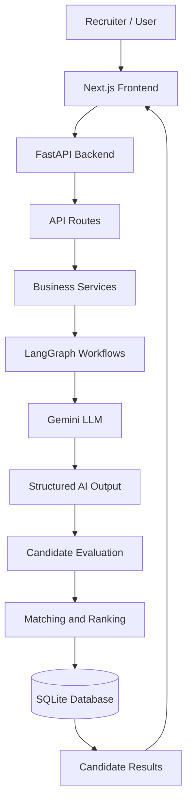
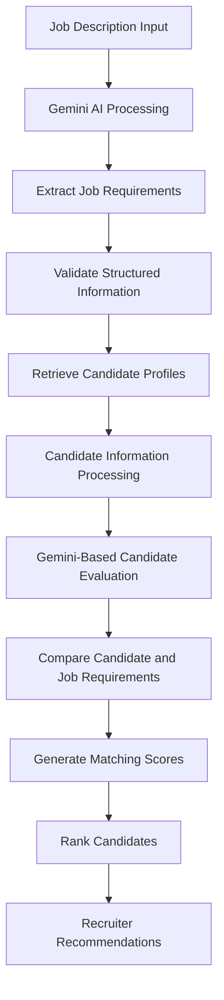

<div align="center">

# 🚀 AI Talent Matching MVP

### Intelligent Recruitment | AI-Powered Candidate Screening | Automated Talent Matching

**Transforming Recruitment with Generative AI and Intelligent Candidate Evaluation**

<p>
  
  
  
  
  
  
</p>

<p>
  <a href="https://github.com/devendrababu9666/AI_Talent_Matching_MVP">
    
  </a>
  <a href="https://github.com/devendrababu9666/AI_Talent_Matching_MVP/network/members">
    
  </a>
</p>

</div>

---

## 📌 Overview

**AI Talent Matching MVP** is an AI-powered recruitment assistance platform designed to simplify and improve the candidate screening and talent acquisition process.

Traditional recruitment often involves manually reviewing hundreds of resumes to identify candidates who match a particular job description. This process is time-consuming, repetitive, and difficult to scale.

This project explores how **Generative AI, Large Language Models (LLMs), and workflow orchestration** can automate important stages of recruitment.

The platform is designed to analyze job descriptions, extract relevant requirements, evaluate candidate profiles, and generate intelligent candidate rankings based on job relevance.

By integrating Google's Gemini models with LangGraph-based workflows, the system aims to provide a structured approach to AI-assisted recruitment.

### 🎯 Key Objectives

- Automate job description analysis.
- Simplify candidate information management.
- Evaluate candidate profiles against job requirements.
- Generate AI-assisted candidate compatibility scores.
- Rank candidates according to their relevance.
- Reduce repetitive manual screening activities.
- Support recruiters with structured, explainable insights.

---

## ✨ Key Features

### 1. 🧠 AI-Powered Job Description Analysis

Leverages Google's Gemini LLM to analyze job descriptions and identify important recruitment requirements.

- Extract relevant skills and qualifications.
- Understand job responsibilities.
- Identify technical requirements.
- Structure extracted information for downstream processing.

### 2. 👨‍💻 Candidate Management

Provides a structured approach to managing candidate information.

- Candidate data storage.
- Resume-related information management.
- Structured candidate records.
- Candidate information retrieval.

### 3. 🎯 Intelligent Candidate Matching

Designed to compare candidate profiles against job requirements.

The matching workflow considers:

- Technical skills.
- Relevant experience.
- Educational qualifications.
- Job-specific requirements.
- Overall candidate relevance.

### 4. 📊 Candidate Ranking and Scoring

The matching workflow is designed to generate compatibility scores on a **0–100 scale**.

Candidates can then be ranked based on their matching relevance.

### 5. 🔄 LangGraph Workflow Orchestration

Uses LangGraph to organize AI-powered processing into structured workflows.

The architecture separates different processing responsibilities, including:

- Job description processing.
- Candidate information ingestion.
- AI-based evaluation.
- Matching and ranking operations.

### 6. ⚡ Modern Full-Stack Architecture

The application follows a frontend-backend architecture:

- Modern web interface.
- FastAPI backend.
- Structured database layer.
- AI-powered processing services.
- Workflow orchestration.

---

## 🏗️ System Architecture

The application follows a modular architecture that separates the user interface, backend services, database operations, and AI workflows.



### Architecture Components

| Component | Responsibility |
|---|---|
| Next.js | Frontend application |
| FastAPI | Backend API development |
| LangGraph | AI workflow orchestration |
| Google Gemini | LLM-powered extraction and evaluation |
| SQLite | Structured data persistence |
| Python | Backend processing and business logic |
| TypeScript | Frontend development |

---

## 🔄 AI Matching Workflow

The proposed recruitment workflow consists of the following stages:



### Workflow Explanation

**Step 1: Job Description Input**

The recruiter provides a job description containing the role, responsibilities, qualifications, and required technical skills.

**Step 2: AI-Based Information Extraction**

Gemini analyzes the job description and extracts relevant information into a structured representation.

**Step 3: Candidate Retrieval**

Candidate information is retrieved from the application's database.

**Step 4: Candidate Evaluation**

The AI evaluation workflow compares candidate information with the extracted job requirements.

**Step 5: Matching Score Generation**

The system generates compatibility scores to represent the relevance of candidate profiles to the job description.

**Step 6: Candidate Ranking**

Candidates are organized according to their matching scores to assist recruiters in identifying relevant profiles.

---

## 🛠️ Technology Stack

### Backend Development

| Technology | Purpose |
|---|---|
| Python | Core backend programming |
| FastAPI | REST API development |
| SQLite | Database management |
| Pydantic | Data validation |
| Uvicorn | ASGI server |

### Generative AI & LLM

| Technology | Purpose |
|---|---|
| Google Gemini 2.5 Flash | AI-powered extraction and candidate evaluation |
| LangGraph | Workflow orchestration |
| Prompt Engineering | Structured LLM interactions |
| Structured Outputs | Consistent AI-generated responses |

### Frontend Development

| Technology | Purpose |
|---|---|
| Next.js | Frontend framework |
| React | UI development |
| TypeScript | Type-safe development |

### Development Tools

- Git and GitHub
- Visual Studio Code
- REST API testing tools

---

## 📂 Project Structure

```text
AI_Talent_Matching_MVP/
│
├── backend/
│   │
│   └── app/
│       ├── api/
│       │   └── routes/
│       │
│       ├── database/
│       │
│       ├── repositories/
│       │
│       ├── schemas/
│       │
│       ├── services/
│       │
│       ├── storage/
│       │
│       ├── extraction/
│       │
│       └── workflows/
│           ├── ingestion/
│           └── matching/
│
├── talent-matching-ui/
│   │
│   ├── src/
│   ├── public/
│   ├── components/
│   └── package.json
│
├── .gitignore
│
└── README.md
```

*Note: Directory names above represent the major architectural areas; consult the actual repository for the complete file-level structure.*

---

## ⚙️ Installation and Setup

Follow these steps to configure the project locally.

### Prerequisites

Make sure you have installed:

- Python 3.10+
- Node.js 18+
- npm
- Git
- Google Gemini API key

### 1. Clone the Repository

```bash
git clone https://github.com/devendrababu9666/AI_Talent_Matching_MVP.git

cd AI_Talent_Matching_MVP
```

### 2. Backend Setup

Navigate to the backend directory:

```bash
cd backend
```

Create a virtual environment:

```bash
python -m venv venv
```

Activate the environment.

**Windows:**

```bash
venv\Scripts\activate
```

**Linux / macOS:**

```bash
source venv/bin/activate
```

Install the required dependencies:

```bash
pip install -r requirements.txt
```

Configure the required environment variables using the project's configuration settings and your Gemini API credentials.

Start the FastAPI server using the application's configured entry point.

### 3. Frontend Setup

Open another terminal:

```bash
cd talent-matching-ui
```

Install dependencies:

```bash
npm install
```

Start the development server:

```bash
npm run dev
```

The frontend and backend should be configured to communicate through the appropriate API base URL.

---

## 🔐 Environment Configuration

The application requires appropriate configuration for its AI integration.

Create a `.env` file in the backend directory and configure the Gemini API credentials using the environment variable expected by the application.

**Important:** Never commit API keys, passwords, or other sensitive credentials to GitHub.

---

## 📈 Future Enhancements

The following improvements can extend the platform into a more comprehensive AI-powered recruitment solution.

- [ ] Advanced resume parsing and information extraction.
- [ ] Semantic similarity-based candidate matching.
- [ ] Vector database integration for semantic retrieval.
- [ ] Explainable AI-based candidate evaluation.
- [ ] Multi-agent recruitment workflows.
- [ ] Automated interview question generation.
- [ ] Candidate skill-gap analysis.
- [ ] Recruiter analytics dashboard.
- [ ] Human-in-the-loop candidate evaluation.
- [ ] Responsible AI and bias monitoring.
- [ ] Comprehensive LLM evaluation framework.
- [ ] Authentication and role-based access control.

---

## 🛡️ Responsible AI Considerations

AI-assisted recruitment should support human decision-making rather than independently determine hiring outcomes.

Important considerations include:

- **Fairness:** Avoid discriminatory evaluation criteria.
- **Transparency:** Provide understandable explanations for matching results.
- **Privacy:** Protect candidate resumes and personal information.
- **Human Oversight:** Keep recruiters involved in final hiring decisions.
- **Reliability:** Evaluate AI-generated outputs before using them in recruitment decisions.

The matching score should be treated as decision-support information, not an objective measure of a candidate's professional worth.

---

## 👨‍💻 Author

<div align="center">

### Devendra Babu Pesarlanka

AI/ML Engineer | Generative AI | Python | Backend Development

Interested in building intelligent applications using Generative AI, LLMs, AI agents, workflow orchestration, and modern backend technologies.

<p>
<a href="https://github.com/devendrababu9666">

</a>

<a href="https://www.linkedin.com/in/pesarlanka-devendrababu/">

</a>
</p>

</div>

---

## ⭐ Support

If you find this project interesting, consider giving the repository a ⭐ on GitHub.

Your support and feedback are appreciated!

---

<div align="center">

### Built with ❤️ using Python, Generative AI, and LangGraph.

**Making Recruitment Smarter with AI.**

</div>
